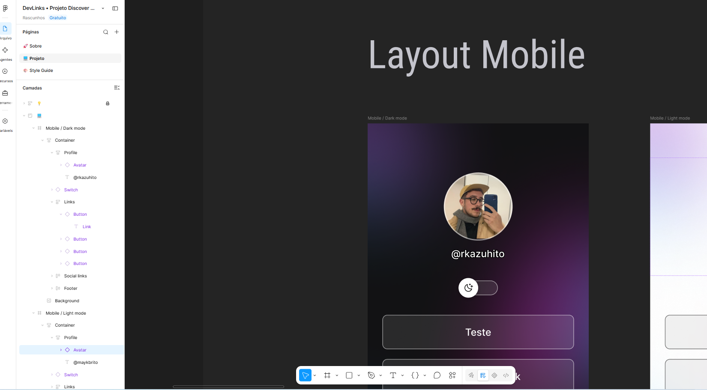

<h1 align="center"> Curriculum </h1>

Projeto para criação de currículo interativo, desenvolvido durante um programa gratuito fornecido pela Rockseat

 

  

## 🚀 Tecnologias

Esse projeto foi desenvolvido com as seguintes tecnologias:

- HTML e CSS
- JavaScript
- Git e Github
- Figma

## 💻 Projeto

Projeto foi criado para gerar um currículo com mais interatividade e para ter uma noção mais ampla das tecnologias de desenvolvimento front end

## :memo: Licença

Esse projeto está sob a licença MIT.

---

     

Feito com ♥
